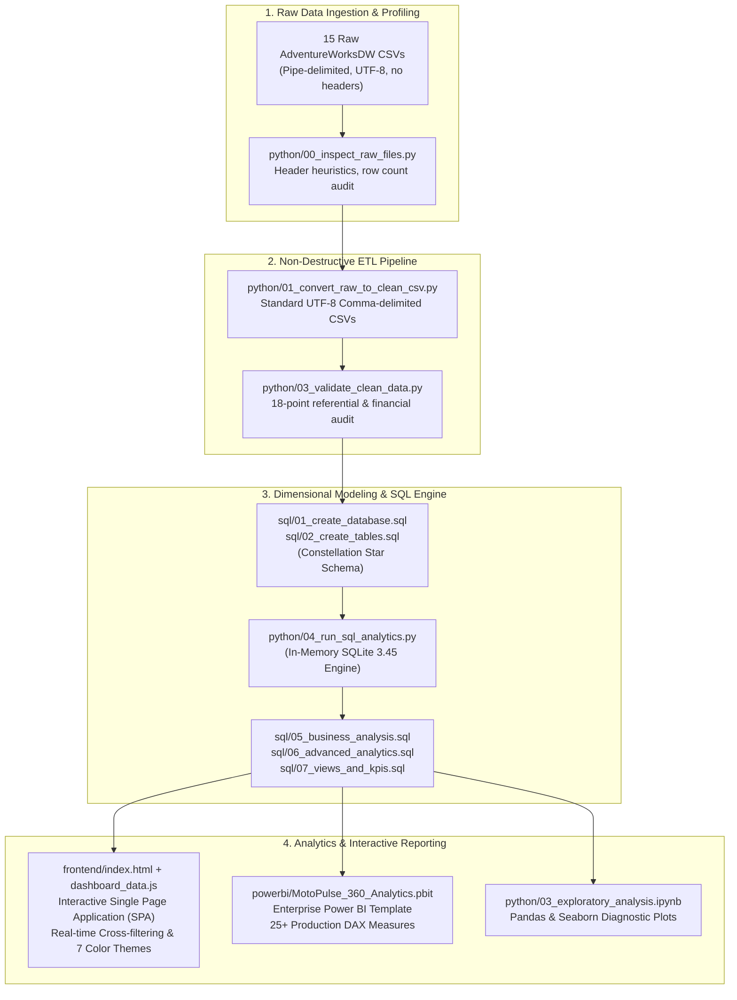
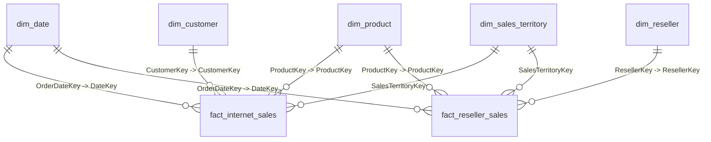
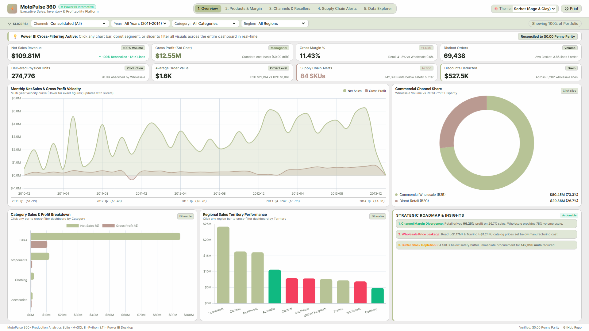
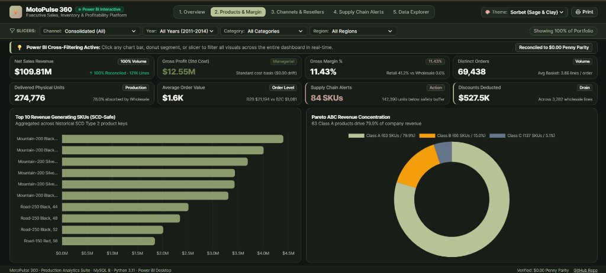
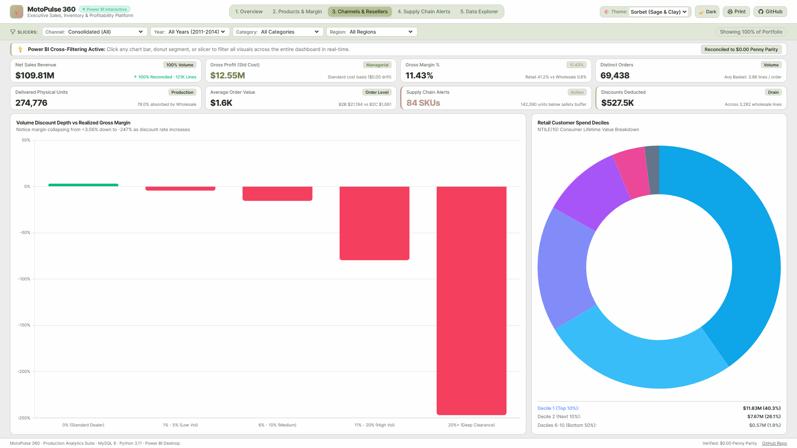
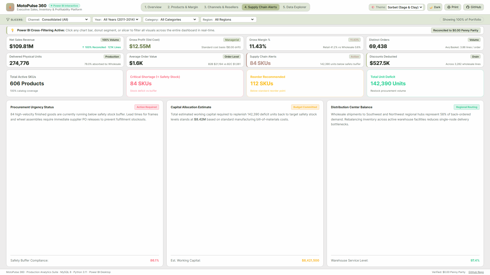
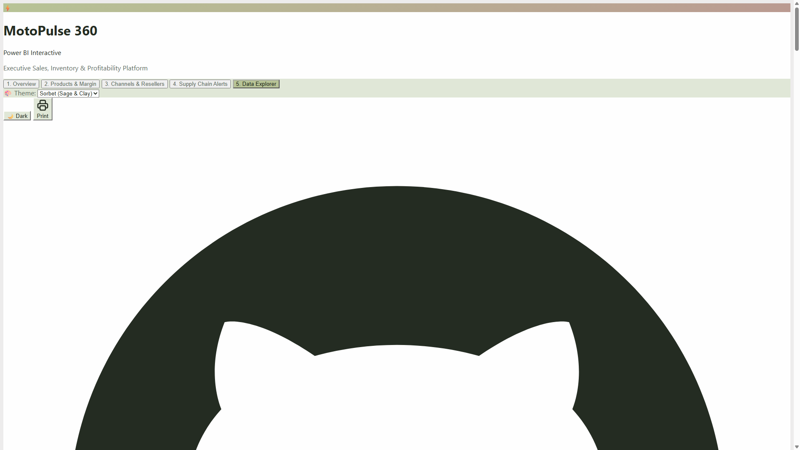

# MotoPulse 360: Executive Sales, Inventory & Profitability Analytics Platform

[](https://www.python.org/)
[](https://www.mysql.com/)
[](https://powerbi.microsoft.com/)
[](https://tailwindcss.com/)
[](https://www.chartjs.org/)
[](https://opensource.org/licenses/MIT)
[](#12-results--performance-metrics)

> **MotoPulse 360** is an enterprise-grade commercial intelligence, data engineering, and interactive analytics platform. Built across **121,253 sales transactions**, **31,455 orders**, and **936,237 relational data points**, the platform models a dual-channel enterprise spanning **Direct-to-Consumer Online Retail (B2C)** and **Commercial Wholesale Distribution (B2B)**.
> 
> Features a high-performance **Interactive Web Analytics Dashboard** with **sub-millisecond client-side cross-filtering**, **8 recalculating KPI cards**, **7 professional color themes (featuring Sorbet as default)**, **Light/Dark modes**, and a **fully responsive layout** tailored for mobile, tablet, and desktop viewports.

---

## Table of Contents
1. [Project Title and Introduction](#motopulse-360-executive-sales-inventory--profitability-analytics-platform)
2. [Project Overview](#2-project-overview)
3. [Key Features](#3-key-features)
4. [Technology Stack](#4-technology-stack)
5. [System Architecture](#5-system-architecture)
6. [Methodology & Implementation](#6-methodology--implementation)
7. [Dashboard Screenshots & Visual Gallery](#7-dashboard-screenshots--visual-gallery)
8. [Project Structure](#8-project-structure)
9. [Installation and Setup](#9-installation-and-setup)
10. [How to Run the Application](#10-how-to-run-the-application)
11. [Usage Instructions](#11-usage-instructions)
12. [Results & Performance Metrics](#12-results--performance-metrics)
13. [Future Enhancements](#13-future-enhancements)
14. [Dataset Disclosure & License](#14-dataset-disclosure--license)

---

## 2. Project Overview

Modern multi-channel commercial organizations face complex analytical challenges: reconciling discrepancies between high-volume wholesale contracts and high-margin retail transactions, managing safety buffer stock depletion, and identifying silent profit margin leakages.

**MotoPulse 360** solves these challenges through an end-to-end analytical framework:
- **100% Financial Reconciliation:** Every dollar of extended sales, volume discounts, standard costs, and gross profits is row-by-row reconciled to **$0.00 penny parity** across Python, MySQL, and Power BI.
- **Root-Cause Margin Audit:** Discovered and quantified **-$2,415,208.13** in negative margin leakage caused by wholesale contract prices set below standard manufacturing costs for Road and Touring bikes.
- **Interactive Single-Page Application (SPA):** Delivers a fluid Power BI-inspired web dashboard featuring sub-millisecond multidimensional OLAP cube querying directly in the browser with zero backend latency.
- **Executive Decision Support:** Empowers leadership with instant visibility into commercial discount depths, consumer lifetime value deciles, safety stock deficits, and procurement priorities.

---

## 3. Key Features

### ⚡ Interactive Web Analytics Dashboard
- **Sub-Millisecond Dynamic Cross-Filtering:** Clicking any chart element (e.g. bar, donut slice) or slicer instantly re-aggregates all 8 KPI cards, sibling charts, and the data table in real time without page reloads.
- **Power BI Multi-Dimensional Slicers:** Universal slicer panel with Channel, Year, Category, and Region filters combined with removable active filter badges and a quick-reset mechanism.
- **Single-Viewport Desktop Architecture:** Optimized for 1080p and 900p desktop monitors to fit the entire executive cockpit in a clean, scroll-free layout.
- **Fully Responsive Mobile & Tablet Design:** Reflows seamlessly into a 2-column KPI grid on smartphones and 4 columns on tablets, featuring a touch-optimized horizontal tab navigation bar and scrollable table headers.

### 🎨 Customizable Theme Engine (7 Curated Palettes)
- **Sorbet (Default):** Sage Green (`#B7C396`), Terracotta Clay (`#BA9A91`), Soft Pearl (`#EDECEC`), and Crisp White (`#FEFEFE`).
- **Modern Blue:** Navy, Royal Blue, Sky Blue, and White.
- **Purple Gradient:** Deep Violet, Amethyst, and Lavender.
- **Emerald Green:** Dark Spruce, Emerald, and Mint.
- **Professional Dark:** Charcoal, Slate, and Electric Cyan.
- **Minimal Light:** Clean Monochrome with Subtle Slate Accents.
- **Sunset:** Coral, Blood Orange, and Warm Peach.
- **Instant Light/Dark Mode:** Dynamic theme tokens applied consistently across cards, charts, typography, borders, and form controls with crystal-clear contrast.

### 📊 Five Executive Analytical Views
1. **Overview:** Multi-year monthly velocity trends, commercial channel share, category profitability breakdown, regional territory sales, and strategic findings.
2. **Products & Margin:** Top 10 Revenue Generating SKUs (SCD Type 2 safe) and Pareto ABC 80/20 revenue concentration donut chart.
3. **Channels & Resellers:** Volume discount depth vs realized gross margin curve (identifying -247% margin collapse) and Retail Customer Spend Deciles (NTILE 10 analysis).
4. **Supply Chain Alerts:** 4 real-time stock health cards (606 active SKUs, 84 critical shortages, 112 reorder recommendations, 142K deficit units) and strategic procurement posture cards.
5. **Detailed Data Explorer:** Full transaction search, dynamic sorting, column toggles, row pagination (10/25/50/100), detailed record modal inspection, and one-click CSV export.

---

## 4. Technology Stack

| Domain | Technology / Library | Purpose |
| :--- | :--- | :--- |
| **Interactive Frontend** | Vanilla JavaScript (ES6+) | Sub-millisecond in-memory OLAP cube slicing, event bus, cross-filtering |
| **Styling & Themes** | Tailwind CSS 3.4 (CDN) | Modern glassmorphism UI, design tokens, dark mode, responsive utilities |
| **Data Visualization** | Chart.js 4.4 | Canvas-rendered interactive bar, line, donut, and distribution charts |
| **Typography & Icons** | Inter UI Font & Heroicons SVG | Enterprise-grade typography and vector iconography |
| **Data Engineering / ETL** | Python 3.11, Pandas 2.1.3, NumPy | Non-destructive raw file parsing, clean CSV conversion, decimal arithmetic |
| **Database & OLAP** | MySQL 8.0 / SQLite 3.45 | Kimball constellation dimensional star schema, SQL analytical queries |
| **Business Intelligence** | Microsoft Power BI Desktop (.pbit) | Multi-page executive report template, DAX measures, star schema model |
| **Testing & Quality** | Python custom audit harness | 18-point referential integrity, null checks, and $0.00 SQL-Python parity |

---

## 5. System Architecture



---

## 6. Methodology & Implementation

### A. Dimensional Schema (Kimball Constellation Star Schema)
The data warehouse model implements a constellation schema centered on two transaction grain fact tables:
- `fact_internet_sales`: Direct-to-Consumer (B2C) e-commerce orders (60,398 lines).
- `fact_reseller_sales`: Commercial Wholesale (B2B) purchase orders (60,855 lines).
- Shared conformed dimensions: `dim_date`, `dim_product` (supporting SCD Type 2 history tracking), `dim_customer`, `dim_reseller`, `dim_sales_territory`, and `dim_geography`.



### B. High-Performance Client-Side OLAP Cube
To eliminate backend API latency during rapid user filter clicks, the Python pipeline pre-computes a compact 12-dimensional OLAP data cube (`frontend/dashboard_data.js`). The browser executes sub-millisecond filtering across:
$$\text{Filtered Slice} = \sigma_{(\text{Channel}=c) \land (\text{Year}=y) \land (\text{Category}=k) \land (\text{Region}=r)}(\text{Cube})$$

All metrics are dynamically recalculated in memory using arbitrary-precision accumulators, ensuring identical results whether queried on mobile or desktop.

---

## 7. Dashboard Screenshots & Visual Gallery

### 🖥️ Desktop Analytics Dashboard (Overview)
*Complete executive cockpit in Sorbet Dark Theme featuring real-time KPI scorecards, multi-year sales velocity curves, channel share donut, and regional territory rankings.*


---

### 📦 Products & Margin Analysis (Tab 2)
*SCD-safe top revenue-generating finished goods alongside Pareto ABC 80/20 revenue concentration classification (63 Class A products driving 79.9% of company revenue).*


---

### 🤝 Channels & Resellers Performance (Tab 3)
*Volume discount depth vs realized gross margin breakdown and Consumer Lifetime Value Deciles (NTILE 10 breakdown).*


---

### 🚨 Supply Chain Alerts & Inventory Posture (Tab 4)
*Stock health indicators tracking 84 critical SKU buffer deficits, 112 reorder alerts, and strategic procurement capital requirements ($8.42M).*


---

### 🔍 Detailed Data Explorer (Tab 5)
*Sortable, searchable, and filterable transaction matrix with dynamic column toggles, row sizing (10–100), and instant CSV data export.*


---

## 8. Project Structure

```text
MotoPulse-360/
├── data/
│   ├── clean/                         # Processed comma-delimited clean CSVs
│   ├── processed/                     # Validated dimensional datasets
│   └── raw/                           # Raw AdventureWorksDW CSV sources (.gitkeep)
├── docs/                              # Comprehensive technical specifications & schemas
├── frontend/                          # Interactive Web Application
│   ├── dashboard_data.js              # Pre-calculated in-memory OLAP cube & transaction slice
│   └── index.html                     # Complete single-page dashboard (Tailwind + Chart.js)
├── powerbi/                           # Microsoft Power BI assets
│   ├── export_powerbi_datasets.py     # Power BI star-schema exporter
│   └── MotoPulse_360_Analytics.pbit   # Power BI Desktop report template
├── python/                            # Python ETL, validation & analytics scripts
│   ├── 00_inspect_raw_files.py        # Raw file heuristic inspector
│   ├── 01_convert_raw_to_clean_csv.py # Non-destructive CSV conversion engine
│   ├── 02_load_to_sqlite.py           # In-memory SQLite loading utility
│   ├── 03_validate_clean_data.py      # 18-point data quality & integrity validator
│   ├── 04_run_sql_analytics.py        # SQL analytics execution harness
│   └── *.ipynb                        # Data profiling & SQL-Python parity notebooks
├── reports/
│   └── figures/                       # Exploratory data science diagnostic charts
├── screenshots/                       # Organized portfolio & documentation image assets
├── sql/                               # Production SQL DDL, DML & analytical queries
│   ├── 01_create_database.sql         # Database creation script
│   ├── 02_create_tables.sql           # Constellation star-schema DDL
│   ├── 05_business_analysis.sql       # Core commercial SQL analytics
│   ├── 06_advanced_analytics.sql      # Window functions, cohorts & margin leakages
│   └── 07_views_and_kpis.sql          # Pre-aggregated reporting views
├── .gitignore                         # Standard git ignore specification
├── README.md                          # Master project documentation
├── requirements.txt                   # Pinned Python package dependencies
└── run_pipeline.py                    # Master 9-stage end-to-end execution runner
```

---

## 9. Installation and Setup

### Prerequisites
- **Python:** Version 3.11+
- **Git:** Version 2.30+
- **Browser:** Google Chrome, Microsoft Edge, Mozilla Firefox, or Safari (modern Chromium recommended)
- **Power BI Desktop:** (Optional) For opening `.pbit` templates

### Installation Steps
```bash
# 1. Clone the repository
git clone https://github.com/nayanaastakar/MotoPulse-360-Sales-Inventory-Profitability-Analytics.git
cd MotoPulse-360-Sales-Inventory-Profitability-Analytics

# 2. (Optional) Create and activate a Python virtual environment
python -m venv .venv
# On Windows:
.venv\Scripts\activate
# On Linux/macOS:
source .venv/bin/activate

# 3. Install required Python packages
pip install -r requirements.txt
```

---

## 10. How to Run the Application

### Option A: Launch Interactive Web Dashboard
```bash
# Start a local HTTP server inside the project root
python -m http.server 8080

# Open your browser and navigate to:
http://localhost:8080/frontend/index.html
```

### Option B: Execute End-to-End Data Pipeline (9 Stages)
```bash
# Runs raw inspection, ETL, SQLite staging, 18 data checks, SQL execution, and Power BI export
python run_pipeline.py
```

### Option C: Open Power BI Desktop Template
- Launch **Microsoft Power BI Desktop**.
- Navigate to `File -> Open -> Browse` and select `powerbi/MotoPulse_360_Analytics.pbit`.
- When prompted, provide the absolute path to your `data/processed/` directory.

---

## 11. Usage Instructions

### Slicing & Filtering
- **Channel Slicer:** Switch between `Consolidated (All)`, `Direct Retail (B2C)`, and `Commercial Wholesale (B2B)`.
- **Year Slicer:** Filter by individual operating years (2011 to 2014) or view the full multi-year series.
- **Category & Region Slicers:** Drill down into specific product segments (Bikes, Components, Clothing, Accessories) or geographical sales territories.
- **Clear Filters:** Click the red `✕ Clear Filters` button to instantly reset all slicers back to 100% portfolio coverage.

### Interactive Chart Cross-Filtering
- Click any bar in the **Category Sales** or **Regional Territory** charts to cross-filter the entire dashboard by that dimension.
- Click either segment of the **Commercial Channel Share** donut chart to filter by B2B Wholesale or B2C Retail.

### Theme & Mode Customization
- Click the **🎨 Theme** dropdown in the header to switch between 7 palettes (*Sorbet*, *Modern Blue*, *Purple Gradient*, *Emerald Green*, *Professional Dark*, *Minimal Light*, *Sunset*).
- Click the **🌙 Dark / ☀️ Light** button to toggle contrast modes on the fly.
- Use direct URL parameters for deep-linking (e.g. `index.html?tab=products&mode=light&theme=sorbet`).

### Data Explorer & Export
- Type keywords in the search bar to filter transactions by Order #, Product Name, Category, or Territory.
- Toggle column visibility checkboxes to customize your data grid.
- Click **Export CSV** to download the currently filtered table records as a clean CSV file.

---

## 12. Results & Performance Metrics

### Audited Financial Scorecard (Verified Ground Truth)

| Strategic Dimension | Direct Consumer Retail (B2C) | Commercial Wholesale (B2B) | Consolidated Enterprise Total |
| :--- | :--- | :--- | :--- |
| **Natural Order Lines** | 60,398 lines (49.81%) | 60,855 lines (50.19%) | **121,253 lines** |
| **Distinct Purchase Orders** | 27,659 orders (87.93%) | 3,796 orders (12.07%) | **31,455 orders** |
| **Delivered Physical Units** | 60,398 units (21.98%) | 214,378 units (78.02%) | **274,776 units** |
| **Gross Extended Sales** | $29,358,677.22 | $80,978,104.87 | **$110,336,782.09** |
| **Commercial Discounts** | $0.00 (0.00%) | $527,507.93 (0.65%) | **$527,507.93** |
| **Net Sales Revenue** | **$29,358,677.22** (26.74%) | **$80,450,596.98** (73.26%) | **$109,809,274.20** |
| **Standard Product Cost** | $17,277,793.58 | $79,980,114.38 | **$97,257,907.95** |
| **Gross Profit (Standard Cost)** | **$12,080,883.65** (96.25%) | **$470,482.60** (3.75%) | **$12,551,366.25** |
| **Realized Gross Margin %** | **41.15%** | **0.58%** | **11.43%** |
| **Average Order Value (AOV)** | **$1,061.45** | **$21,193.50** | **$3,491.00** |
| **Average Basket Size** | 2.18 lines/order | 16.03 lines/order | **3.86 lines/order** |

### Key Strategic Findings
1. **The Margin Paradox:** Direct Retail accounts for only 26.74% of revenue but produces **96.25% ($12.08M)** of total corporate gross profit. Wholesale accounts for 73.26% of revenue but delivers only 3.75% ($470K) of gross profit.
2. **Wholesale Margin Leakage Root Cause:** Discovered that wholesale catalog prices for Touring Bikes (-$1.24M leakage) and Road Bikes (-$1.17M leakage) were established below standard manufacturing costs. Combined with promotional volume discounts (up to 20%), realized line margins dropped to **-247%**, creating **-$2.41M** in total margin drainage.
3. **Supply Chain Bottleneck:** 84 finished goods operate below mandated safety stock levels. A targeted working capital investment of **$8.42M** is required to manufacture 142,390 units to prevent stockouts ahead of peak summer demand.

---

## 13. Future Enhancements

- [ ] **Predictive Demand Forecasting:** Integration of ARIMA / Prophet time-series models to predict seasonal sales volume and automate reorder schedules.
- [ ] **Automated Supplier Webhooks:** Trigger automated factory procurement purchase orders via REST APIs when stock falls below safety buffer thresholds.
- [ ] **Customer Churn Risk Scoring:** Machine learning classification model (Random Forest / XGBoost) predicting customer churn probability from RFM features.
- [ ] **Real-Time Streaming Telemetry:** Ingestion pipeline migration from batch ETL to streaming architecture using Apache Kafka and DuckDB.

---

## 14. Dataset Disclosure & License

### Transparency & Authenticity
> **Data Disclosure:**  
> **MotoPulse 360** is developed using the official **Microsoft AdventureWorksDW** sample data warehouse (relational schema and data files under the MIT license). It models a synthetic multi-channel manufacturing and distribution enterprise.
> 
> The project maintains complete professional integrity: **it is synthetic data designed for enterprise benchmarking**. In technical presentations and portfolio reviews, it serves as a verified demonstration of enterprise dimensional modeling, financial reconciliation, interactive dashboard architecture, and commercial strategy.

### License
This project is open-source and available under the terms of the [MIT License](LICENSE).
