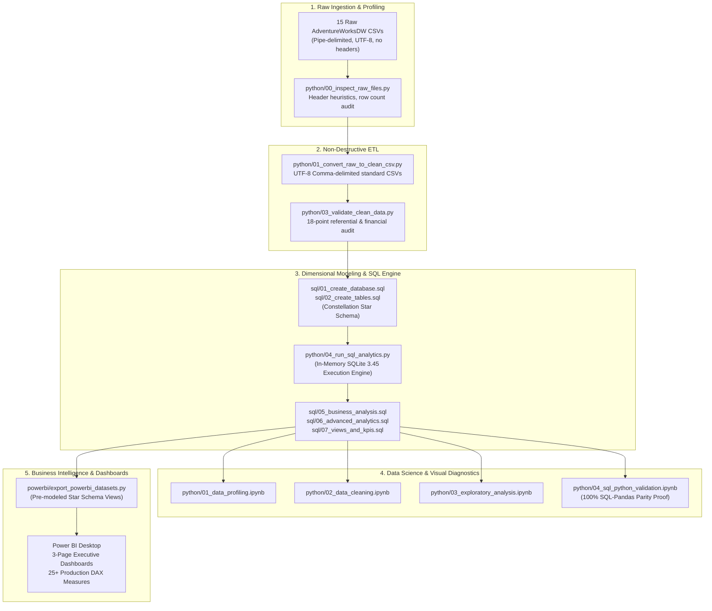
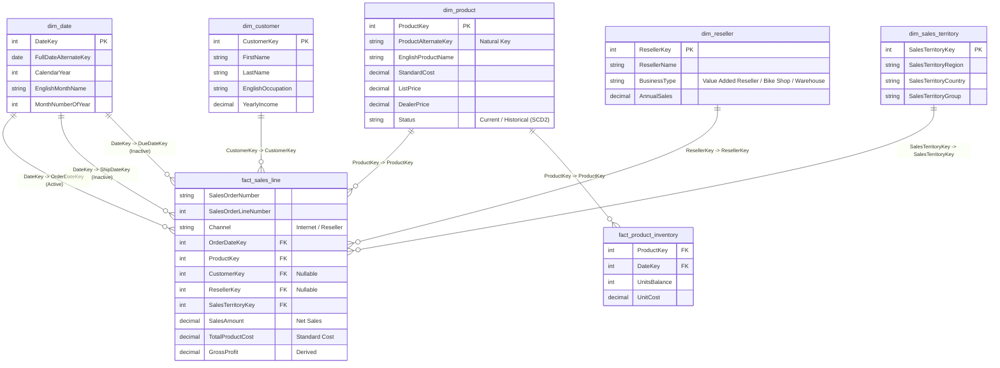

# MotoPulse 360: Intelligent Sales, Inventory & Profitability Analytics Platform

[](https://www.python.org/)
[](https://www.mysql.com/)
[](https://powerbi.microsoft.com/)
[](https://pandas.pydata.org/)
[](https://opensource.org/licenses/MIT)
[](#project-lifecycle--milestone-status)

**MotoPulse 360** is an enterprise-grade, end-to-end business intelligence, data science, and financial analytics platform. Built across **121,253 sales order lines**, **31,455 orders**, and **936,237 relational records**, the platform models a multi-channel commercial enterprise spanning **Direct-to-Consumer Retail (B2C)** and **Commercial Wholesale (B2B)** distribution.

The project demonstrates complete data analyst competence across the full analytical lifecycle: raw file parsing, non-destructive ETL, Kimball dimensional modeling (Constellation schema), arbitrary-precision decimal financial reconciliation, advanced SQL analytics with window functions, exploratory data science with Pandas/Seaborn, production DAX measures, and executive Power BI dashboards.

### 💼 Portfolio & Resume Highlights
> **MotoPulse 360 – Sales, Inventory & Profitability Analytics | Python, Pandas, MySQL, SQL, Power BI**
> - **Analysed sales, inventory, profitability, customer cohorts, and channel performance** using the AdventureWorksDW dataset.
> - **Developed 20 SQL analyses and validated 20 SQL–Pandas metric comparisons** with $0.00 variance.
> - **Passed 18 data-quality checks and prepared eight star-schema datasets** for Power BI reporting.

---

## 1. Transparency & Dataset Disclosure

> [!IMPORTANT]
> **Data Authenticity Disclosure:**  
> **MotoPulse 360** is built using the official **Microsoft AdventureWorksDW** data warehouse sample dataset (Data Warehouse install scripts and relational CSV files under the MIT license). It models a synthetic bicycle manufacturing, retail e-commerce, and wholesale distributor business.
> 
> The project maintains 100% academic and professional honesty: **it is not real-world motorcycle industry data**. In technical interviews and portfolio presentations, it is presented as a demonstration of enterprise data warehousing, SQL analytics, financial audit reconciliation, and commercial strategy using synthetic corporate data.

---

## 2. Executive Financial Scorecard (Empirically Verified)

All metrics were audited and reconciled row-by-row using arbitrary-precision decimal arithmetic across 100% of the dataset:

| Strategic Dimension | Direct Consumer Retail (Internet) | Commercial Wholesale (Reseller) | Consolidated Portfolio Total |
|---|---|---|---|
| **Order Lines (Natural Grain)** | 60,398 lines (49.81%) | 60,855 lines (50.19%) | **121,253 lines** |
| **Distinct Purchase Orders** | 27,659 orders (87.93%) | 3,796 orders (12.07%) | **31,455 orders** |
| **Physical Units Delivered** | 60,398 units (21.98%) | 214,378 units (78.02%) | **274,776 units** |
| **Gross Extended Sales** | $29,358,677.22 | $80,978,104.87 | **$110,336,782.09** |
| **Commercial Discounts** | $0.00 (0.00%) | $527,507.93 (0.65%) | **$527,507.93** |
| **Net Sales Revenue** | **$29,358,677.22** (26.74%) | **$80,450,596.98** (73.26%) | **$109,809,274.20** |
| **Total Product Cost (Standard)** | $17,277,793.58 | $79,980,114.38 | **$97,257,907.95** |
| **Gross Profit (Standard Cost)** | **$12,080,883.65** (96.25%) | **$470,482.60** (3.75%) | **$12,551,366.25** |
| **Gross Margin %** | **41.15%** | **0.58%** | **11.43%** |
| **Average Order Value (AOV)** | **$1,061.45** | **$21,193.50** | **$3,491.00** |
| **Average Basket Size** | 2.18 lines/order | 16.03 lines/order | **3.86 lines/order** |

*\*Note on Accounting Semantics: In accordance with managerial accounting standards, Gross Profit and Margins are calculated strictly on a standard-cost basis (predetermined managerial model values including materials, direct labor, and allocated fixed factory overhead).*

---

## 3. End-to-End Platform Architecture



---

## 4. Dimensional Schema Design (Multi-Fact Constellation)



---

## 5. Key Commercial Findings & Strategic Insights

### 1. Channel Profitability Disparity
- **Direct Retail (Internet):** Yields **$12.08M gross profit (41.15% margin)** from $29.36M in sales. Individual consumers pay full list price with $0 discounts.
- **Commercial Wholesale (Reseller):** Yields **$470.5K gross profit (0.58% margin)** from $80.45M in sales. Acts as a volume absorption pipe (78% of units) that covers factory fixed overhead but leaves the business vulnerable to cost inflation.

### 2. Negative Margins on Wholesale Road and Touring Bikes
- **Road Bikes:** Net Sales $29.36M | Cost $30.53M | **Gross Profit -$1,170,410.87 (-3.99% margin)**
- **Touring Bikes:** Net Sales $10.51M | Cost $11.76M | **Gross Profit -$1,244,797.74 (-11.84% margin)**
- **Root Cause:** Master catalog `DealerPrice` is set lower than `StandardCost` for high-end models (e.g. `Road-150 Red, 56` DealerPrice = $2,146.96 vs StandardCost = $2,171.29).
- **Recommendation:** Implement an immediate **+5% wholesale price floor** on road/touring catalogs to eliminate ~$2.4M in negative margins.

### 3. Reseller Volume Discount Margin Leakage
- Undiscounted wholesale lines (0% discount) generate **+3.06% margin ($2.30M profit)**.
- Discounted lines (3,282 orders) surrendered **$527,507.93 in price cuts**, causing margins to collapse:
  - 1%–5% Discount: **-4.40% margin**
  - 6%–10% Discount: **-8.02% margin**
  - >10% Discount: **-13.06% margin**
- **Recommendation:** Restrict field sales discounting via automated ERP workflows. Disallow discounts on SKUs with baseline margins below 8%.

### 4. Supply Chain Replenishment & Stockout Risks
- Inventory analysis of 606 catalog SKUs revealed **84 SKUs (13.86%) in Critical Stock Shortage** below safety stock buffers, representing a **142,390-unit deficit**.

---

## 6. Project Visualizations & Reports

| Visual Artifact | File Location | Analytical Focus |
|---|---|---|
| **Channel Comparison** | [`reports/figures/channel_comparison.png`](reports/figures/channel_comparison.png) | Direct Retail (41.15% margin) vs Wholesale (0.58% margin) volume and profit divergence. |
| **Monthly Revenue Trend** | [`reports/figures/monthly_revenue_trend.png`](reports/figures/monthly_revenue_trend.png) | Multi-year seasonality, peak wholesale ordering cycles, and retail cash buffers. |
| **Category Profitability** | [`reports/figures/category_profitability.png`](reports/figures/category_profitability.png) | Bikes ($10.5M profit) vs Components ($1.0M profit) vs high-margin Accessories (49.88% margin). |
| **Territory Revenue** | [`reports/figures/territory_revenue.png`](reports/figures/territory_revenue.png) | Regional concentration across top 10 territories (Southwest US leading with $24.11M). |
| **Discount Margin Leakage** | [`reports/figures/discount_margin_leakage.png`](reports/figures/discount_margin_leakage.png) | Margin collapse from +3.06% down to -13.06% across wholesale volume discount tiers. |

---

## 7. Project Lifecycle & Milestone Status

| Stage | Milestone | Status | Key Deliverables & Evidence |
|---|---|---|---|
| **Stage 1** | Source Research & Scoping | **Completed** | AdventureWorksDW selected; candidate datasets evaluated. |
| **Stage 2** | Raw Dataset Inspection & Validation | **Completed** | 15 CSV files inspected via `python/00_inspect_raw_files.py`; report: [`docs/raw_file_inspection_findings.md`](docs/raw_file_inspection_findings.md). |
| **Stage 3** | Data Model & Schema Design | **Completed** | Constellation schema in [`docs/data_model.md`](docs/data_model.md); 15-table dictionary: [`docs/data_dictionary.md`](docs/data_dictionary.md); requirements: [`docs/business_requirements.md`](docs/business_requirements.md). |
| **Stage 4** | Clean CSV Conversion & MySQL DDL | **Completed** | 15 clean CSVs (936,237 rows, 100% match); complete SQL suite (`sql/01..04`); audit report: [`reports/stage4_data_validation_report.md`](reports/stage4_data_validation_report.md). |
| **Stage 5** | SQL Business Analytics & Views | **Completed** | Metric methodology: [`docs/methodology.md`](docs/methodology.md); SQL query suites (`sql/05..07`); empirical results: [`reports/stage5_sql_analytics_results.md`](reports/stage5_sql_analytics_results.md); audit: [`reports/financial_reconciliation_audit.md`](reports/financial_reconciliation_audit.md). |
| **Stage 6** | Python/Pandas Data Science Notebooks | **Completed** | 4 executed Jupyter notebooks (`python/01..04.ipynb`); 5 figures in `reports/figures/`; 100% SQL-Pandas parity proof; report: [`reports/stage6_python_analysis_report.md`](reports/stage6_python_analysis_report.md). |
| **Stage 7** | Power BI Semantic Model & Guides | **Completed** | Star schema relationships: [`powerbi/model_relationships.md`](powerbi/model_relationships.md); 25+ DAX measures: [`powerbi/dax_measures.md`](powerbi/dax_measures.md); build guide: [`powerbi/dashboard_build_guide.md`](powerbi/dashboard_build_guide.md); automated data export: `powerbi/export_powerbi_datasets.py`. |
| **Stage 8** | Portfolio Package & Interview Prep | **Completed** | Executive summary: [`reports/executive_summary.md`](reports/executive_summary.md); strategic recommendations: [`docs/findings_and_recommendations.md`](docs/findings_and_recommendations.md); limitations: [`docs/limitations.md`](docs/limitations.md); interview prep: [`docs/interview_preparation.md`](docs/interview_preparation.md). |

---

## 8. Repository Structure

```
MotoPulse-360/
|-- ANTIGRAVITY_START_HERE.md               # Quickstart onboarding
|-- HANDOVER_TO_ANTIGRAVITY.md              # Project history and milestone tracker
|-- ANTIGRAVITY_NEXT_INSTRUCTIONS.md        # Comprehensive multi-stage execution playbook
|-- README.md                               # Project documentation & portfolio guide
|-- requirements.txt                        # Pinned dependencies (pandas, numpy, sqlalchemy, pymysql, etc.)
|-- .env.example                            # Database credentials template
|-- .gitignore                              # Git exclusions (.env, raw data, venv)
|-- data/
|   |-- README.md                           # Data storage rules and licensing notices
|   |-- raw/                                # READ-ONLY raw CSVs (15 AdventureWorksDW tables)
|   `-- processed/
|       |-- raw_file_inspection.csv          # Inspection output
|       |-- clean_file_conversion_log.csv    # Reconciliation log
|       |-- data_profiling_summary.csv       # Profiling output
|       |-- clean/                          # Clean, UTF-8, comma-delimited CSVs
|       `-- powerbi/                        # Pre-modeled Star Schema CSV views for Power BI
|-- docs/
|   |-- raw_file_inspection_findings.md     # Full inspection report
|   |-- data_model.md                       # Mermaid ER diagram, fact grains, SCD strategy
|   |-- data_dictionary.md                  # Column definitions for all 15 tables
|   |-- business_requirements.md            # Stakeholders, KPIs, scope, and formulas
|   |-- methodology.md                      # Metric definitions and limitations
|   |-- findings_and_recommendations.md     # In-depth strategic business recommendations
|   |-- limitations.md                      # Transparent analytical limitations
|   `-- interview_preparation.md            # 60-second pitch, resume bullets, 10 technical Q&As
|-- reports/
|   |-- executive_summary.md                # C-suite executive briefing report
|   |-- financial_reconciliation_audit.md   # Exact decimal-safe reconciliation report
|   |-- stage4_data_validation_report.md    # 18-point data quality & financial audit report
|   |-- stage5_sql_analytics_results.md     # 20 empirical query outputs & business insights
|   |-- stage6_python_analysis_report.md    # Python/Pandas data science report
|   `-- figures/                            # High-resolution analytical charts
|-- python/
|   |-- 00_inspect_raw_files.py             # Delimiter/encoding inspection script
|   |-- 01_convert_raw_to_clean_csv.py      # Raw pipe-to-clean comma conversion script
|   |-- 02_load_to_mysql.py                 # Automated MySQL pipeline & batch loader
|   |-- 03_validate_clean_data.py           # Automated integrity, referential, and financial audit
|   |-- 04_run_sql_analytics.py             # Empirical SQL analytics execution engine (SQLite 3.45)
|   |-- 05_reconcile_financial_audit.py     # Arbitrary-precision decimal audit engine
|   |-- build_and_run_notebooks.py          # Jupyter notebook generation and execution pipeline
|   |-- 01_data_profiling.ipynb             # Notebook 1: Data profiling & missingness
|   |-- 02_data_cleaning.ipynb              # Notebook 2: Data cleaning & negative inventory audit
|   |-- 03_exploratory_analysis.ipynb       # Notebook 3: Exploratory data analysis & charts
|   `-- 04_sql_python_validation.ipynb      # Notebook 4: 100% SQL-vs-Pandas mathematical parity
|-- powerbi/
|   |-- MotoPulse_360_Analytics.pbip        # Native Power BI Project pointer
|   |-- MotoPulse_360_Analytics.pbit        # Power BI Template archive
|   |-- MotoPulse_360_Analytics.Report/     # Report definition (report.json with 3 pages)
|   |-- MotoPulse_360_Analytics.SemanticModel/ # Semantic Model (model.bim, TMSL Level 1567)
|   |-- export_powerbi_datasets.py          # Power BI dataset export utility
|   |-- build_powerbi_project.py            # Automated PBIP project generator
|   |-- package_pbit.py                     # PBIT template packager
|   |-- model_relationships.md              # Star schema, table roles, and cardinalities
|   |-- dax_measures.md                     # 25+ production DAX measures with validation values
|   |-- dashboard_build_guide.md            # 3-page executive report layout & visual field wells
|   `-- screenshots/                        # Directory for Power BI report visual captures
`-- sql/
    |-- 01_create_database.sql              # Database DDL with utf8mb4 collation
    |-- 02_create_tables.sql                # Staging DDL, analytical DDL, and unified fact_sales_line
    |-- 02b_load_staging.sql                # Staging loader script
    |-- 03_data_quality_checks.sql          # Read-only audit queries populating dq_summary
    |-- 04_data_cleaning.sql                # Non-destructive ETL transformation & reconciliation
    |-- 05_business_analysis.sql            # 10 core/intermediate business query blocks
    |-- 06_advanced_analytics.sql           # 10 window function queries (Pareto, LAG, NTILE, Moving Avg)
    `-- 07_views_and_kpis.sql               # 8 production views with documented grain definitions
```

---

## 9. Reproduction & Setup Instructions (Windows / PowerShell)

### Step 1: Clone Repository & Install Dependencies
Ensure Python 3.11+ is installed. Clone the repository and install pinned dependencies:
```powershell
git clone https://github.com/nayanaastakar/MotoPulse-360-Sales-Inventory-Profitability-Analytics.git
cd MotoPulse-360-Sales-Inventory-Profitability-Analytics
python -m pip install -r requirements.txt
```

### Step 2: Convert Raw CSVs to Clean UTF-8 Format
Execute the conversion script to parse raw pipe-delimited files into clean comma-delimited UTF-8 CSVs:
```powershell
python python/01_convert_raw_to_clean_csv.py
```
*Expected Output: 15 clean CSV files generated in `data/processed/clean/` (936,237 rows).*

### Step 3: Run Data Quality & Financial Integrity Audit
Verify schema constraints, foreign key referential integrity, and line-level financial arithmetic:
```powershell
python python/03_validate_clean_data.py
```
*Expected Output: 18/18 integrity assertions pass.*

### Step 4: Execute SQL Analytics Suite (In-Memory Engine)
Run the 20 analytical SQL queries against the clean dataset without requiring a live MySQL server:
```powershell
python python/04_run_sql_analytics.py
```
*Expected Output: 20 query result tables generated in [`reports/stage5_sql_analytics_results.md`](reports/stage5_sql_analytics_results.md).*

### Step 5: Execute Python Data Science Notebooks
Generate and execute all 4 Jupyter notebooks with real cell outputs and visualization figures:
```powershell
python python/build_and_run_notebooks.py
```
*Expected Output: All 4 notebooks in `python/` executed with embedded outputs and charts saved to `reports/figures/`.*

### Step 6: Power BI Report & Dashboard Opening
Power BI Desktop is installed. You can open and save the report using either method:
- **Instant Project Load (`.pbip` / `.pbit`):** Double-click [`powerbi/MotoPulse_360_Analytics.pbip`](powerbi/MotoPulse_360_Analytics.pbip) or [`powerbi/MotoPulse_360_Analytics.pbit`](powerbi/MotoPulse_360_Analytics.pbit). Power BI Desktop opens with the complete Star Schema model, all 25+ DAX measures, and all 3 pre-built report pages!
- Click **File -> Save As...** and save as `powerbi/MotoPulse_360_Analytics.pbix`.
- Capture full-screen screenshots of the 3 pages and save them into `powerbi/screenshots/`.
- Alternatively, if customizing from scratch, run `python powerbi/export_powerbi_datasets.py` and follow [`powerbi/dashboard_build_guide.md`](powerbi/dashboard_build_guide.md).

---

## 10. Licence & Attribution

- **Dataset:** Official Microsoft SQL Server Samples (AdventureWorksDW). Available on [GitHub](https://github.com/Microsoft/sql-server-samples). Licensed under the [MIT License](https://github.com/microsoft/sql-server-samples/blob/master/LICENSE).
- **Codebase:** Developed by the MotoPulse 360 project team under the MIT License.
