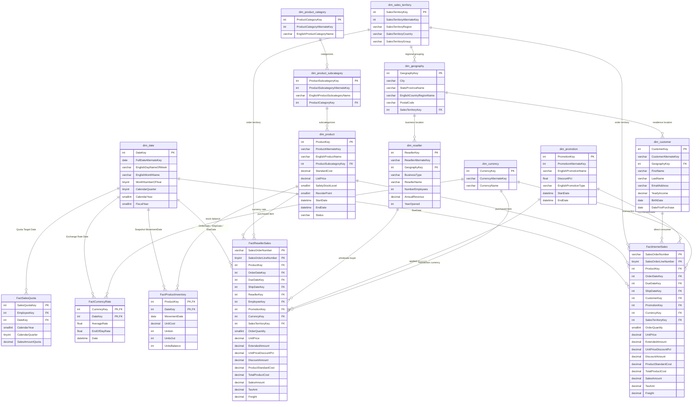

# MotoPulse 360: Enterprise Data Model & Schema Architecture

**Project:** MotoPulse 360 (Intelligent Sales, Inventory & Profitability Analytics Platform)  
**Data Source:** Microsoft AdventureWorksDW (Official Sample Data Warehouse)  
**Disclosure:** MotoPulse 360 utilizes Microsoft AdventureWorksDW, a fictional synthetic bicycle manufacturing, retail, and commercial wholesale dataset. It does not represent real-world motorcycle industry data.  
**Architecture Pattern:** Multi-Fact Star / Constellation Schema  
**Target RDBMS:** MySQL 8.x Community Server  
**Date:** 2026-10-20  

---

## 1. Enterprise Architecture Overview

The MotoPulse 360 analytical data model is structured as a **Constellation Schema (Multi-Fact Star Schema)**. It connects shared (conformed) dimensions across four distinct operational business processes:
1. **Direct-to-Consumer (B2C) Retail Sales** (`FactInternetSales`)
2. **Commercial (B2B) Wholesale Reseller Sales** (`FactResellerSales`)
3. **Daily Product Inventory Snapshots** (`FactProductInventory`)
4. **Commercial Sales Performance & Currency Valuation** (`FactSalesQuota`, `FactCurrencyRate`)

Conformed dimensions (`dim_date`, `dim_product`, `dim_sales_territory`, `dim_currency`, `dim_promotion`, `dim_geography`) provide standardized filtering, slicing, and drill-down across all analytical facts without semantic divergence.

```
       +-------------------------------------------------------+
       |                      dim_date                         |
       +-------------------------------------------------------+
           |           |                   |              |
           |           |                   |              +--------------+
           |           |                   |                             |
           v           v                   v                             v
+-------------------+ +-------------------+ +-----------------------+ +--------------------+
| FactInternetSales | | FactResellerSales | | FactProductInventory  | | FactSalesQuota /   |
| (Retail Sales)    | | (Wholesale Sales) | | (Daily Stock Snapshot)| | FactCurrencyRate   |
+-------------------+ +-------------------+ +-----------------------+ +--------------------+
           ^                   ^                   ^
           |                   |                   |
           +-------------------+-------------------+
                               |
                   +-----------------------+
                   |      dim_product      |
                   +-----------------------+
                               |
                   +-----------------------+
                   | dim_product_subcat    |
                   +-----------------------+
                               |
                   +-----------------------+
                   | dim_product_category  |
                   +-----------------------+
```

---

## 2. Mermaid Entity-Relationship Diagram



---

## 3. Fact Table Grains and Disjoint Channels

Understanding and respecting fact grains is vital to avoid data corruption, double-counted revenue, and misleading averages.

### 3.1. FactInternetSales (B2C Retail Channel)
- **Natural Grain:** Exactly **one sales order line** identified by the composite natural key `(SalesOrderNumber, SalesOrderLineNumber)`.
- **Row Count:** 60,398 rows.
- **Order Count:** 27,659 unique orders (average 2.18 lines per order).
- **Customer Entity:** References `DimCustomer` via `CustomerKey`. Every row has a valid customer key (0 orphans).
- **Discount Semantics:** Line-level discount is 0.00 across all 60,398 rows (`UnitPriceDiscountPct = 0`, `DiscountAmount = 0.00`). Retail consumers pay list/dealer price without volume discounting.
- **Date Coverage:** `OrderDate` ranges from 2010-12-29 to 2014-01-28.

### 3.2. FactResellerSales (B2B Wholesale Channel)
- **Natural Grain:** Exactly **one sales order line** identified by the composite natural key `(SalesOrderNumber, SalesOrderLineNumber)`.
- **Row Count:** 60,855 rows.
- **Order Count:** 3,796 unique orders (average 16.03 lines per order — classic high-volume wholesale purchasing).
- **Buyer Entity:** References `DimReseller` via `ResellerKey`. Every row has a valid reseller key (0 orphans). Contains `EmployeeKey` attributing sales to internal sales representatives.
- **Discount Semantics:** Volume discounts applied actively. 3,282 rows have discounts up to 40% (mean non-zero discount: 9.3%).
- **Date Coverage:** `OrderDate` ranges from 2010-12-29 to 2013-11-29.

### 3.3. Unified Sales Fact Architecture (`fact_sales_line`)
To support unified executive analytics across both channels without duplicating reporting pipelines or creating Cartesian join products, `FactInternetSales` and `FactResellerSales` are consolidated via a **UNION ALL** staging/analytical table and view (`fact_sales_line`):

```sql
-- Stacking Logic: Unified Grain
SELECT 
    'Internet' AS channel,
    SalesOrderNumber,
    SalesOrderLineNumber,
    ProductKey,
    OrderDateKey,
    DueDateKey,
    ShipDateKey,
    CustomerKey,
    NULL AS ResellerKey,
    NULL AS EmployeeKey,
    PromotionKey,
    CurrencyKey,
    SalesTerritoryKey,
    OrderQuantity,
    UnitPrice,
    ExtendedAmount,
    UnitPriceDiscountPct,
    DiscountAmount,
    ProductStandardCost,
    TotalProductCost,
    SalesAmount,
    TaxAmt,
    Freight
FROM FactInternetSales
UNION ALL
SELECT 
    'Reseller' AS channel,
    SalesOrderNumber,
    SalesOrderLineNumber,
    ProductKey,
    OrderDateKey,
    DueDateKey,
    ShipDateKey,
    NULL AS CustomerKey,
    ResellerKey,
    EmployeeKey,
    PromotionKey,
    CurrencyKey,
    SalesTerritoryKey,
    OrderQuantity,
    UnitPrice,
    ExtendedAmount,
    UnitPriceDiscountPct,
    DiscountAmount,
    ProductStandardCost,
    TotalProductCost,
    SalesAmount,
    TaxAmt,
    Freight
FROM FactResellerSales;
```

**Key Architectural Rules for `fact_sales_line`:**
1. **Primary Key:** `(channel, SalesOrderNumber, SalesOrderLineNumber)`. Because order numbers between Internet (`SO43697...`) and Reseller (`SO43659...`) have **zero overlap**, this composite key is guaranteed unique across all 121,253 rows.
2. **Channel Key Exclusivity Constraint:**
   `CHECK ((channel = 'Internet' AND CustomerKey IS NOT NULL AND ResellerKey IS NULL) OR (channel = 'Reseller' AND CustomerKey IS NULL AND ResellerKey IS NOT NULL))`
3. **No Direct Inter-Fact Joins:** Never execute `FactInternetSales JOIN FactResellerSales`. They are completely independent sales streams.

### 3.4. FactProductInventory (Daily Snapshot)
- **Natural Grain:** Exactly **one product on one calendar date** `(ProductKey, DateKey)`.
- **Row Count:** Exactly 776,286 rows = 606 products × 1,281 calendar days (from 2010-12-28 to 2014-06-30).
- **Semantics:** Daily inventory ledger snapshot.
- **Balance Equation:** Validated on real data: `UnitsBalance_today = UnitsBalance_yesterday + UnitsIn - UnitsOut`.
- **Absence of Warehouse Key:** `FactProductInventory` contains no warehouse dimension key. Inventory tracking in AdventureWorksDW is modeled strictly at the enterprise product level.
- **Synthetic Artefacts:** `UnitsBalance` ranges from -494 to +875. Negative balances represent simulated stock deficits and must be flagged rather than dropped.

### 3.5. FactCurrencyRate & FactSalesQuota
- `FactCurrencyRate`: Grain = `(CurrencyKey, DateKey)`. Daily exchange rate for foreign currencies against USD (14,264 rows).
- `FactSalesQuota`: Grain = `(EmployeeKey, DateKey)`. Quarterly quota targets assigned to sales reps (163 rows).

---

## 4. Slowly Changing Dimensions (SCD Type 2) Strategy: DimProduct

### 4.1. The Empirical Reality
Inspection of `DimProduct.csv` revealed:
- **Total Rows:** 606 rows.
- **Unique Products (`ProductAlternateKey`):** 504 products.
- **SCD Type 2 Products:** Exactly 77 products have multiple versions (e.g. `ProductAlternateKey = 'FR-M94S-38'` has `ProductKey` 307, 308, and 309).
- **Tracking Mechanism:** Each version has a distinct surrogate `ProductKey`, a valid `StartDate`, an `EndDate` (NULL for the currently active version), and a `Status` (`Current` or NULL).

### 4.2. Modeling & Join Strategy
Joining sales transactions directly to a product dimension that contains historical versions can lead to catastrophic reporting errors if handled improperly:
1. **Fact-to-Dimension Foreign Key:** Every transaction in `FactInternetSales`, `FactResellerSales`, and `FactProductInventory` already contains the specific surrogate `ProductKey` in effect at the time the transaction took place.
   - Joining `fact.ProductKey = dim_product.ProductKey` is a strict **N:1 relationship**.
   - It **never multiplies rows** and preserves the exact historical cost (`StandardCost`) and list price (`ListPrice`) in effect on the order date.
2. **Product-Level Reporting & Rollups:** When executives analyze performance by product over multi-year periods (e.g., "What were total sales of the Mountain-100 Silver 38cm frame?"), grouping by `ProductKey` would artificially split the product into 2 or 3 separate lines.
   - **Correct Rule:** Group by `ProductAlternateKey` or `EnglishProductName` when calculating cumulative product revenue.
   - **Current Attribute Slicing:** To filter by current product attributes, link through the dimensional hierarchy (`ProductAlternateKey`) or query `dim_product WHERE Status = 'Current'` or `EndDate IS NULL`.

---

## 5. Warehouse vs Sales Territory Architecture

### 5.1. Clarification of "Warehouse" in AdventureWorksDW
A common misconception in AdventureWorksDW is that `DimReseller.BusinessType = 'Warehouse'` represents the retailer's inventory depot or fulfillment center.
- **Empirical Evidence:** In `DimReseller`, `BusinessType` contains values: `Value Added Reseller`, `Specialty Bike Shop`, and `Warehouse`.
- **Business Meaning:** In this schema, "Warehouse" is a classification of commercial customer (e.g., a wholesale club or bulk discount warehouse chain that purchases from AdventureWorks), **not** an internal stocking warehouse.
- **Internal Fulfillment:** AdventureWorksDW provides no physical internal warehouse tracking.

### 5.2. Sales Territory as the Primary Operational / Geographic Entity
Geographic operational analysis is modeled through `dim_sales_territory` and `dim_geography`:
- `dim_sales_territory` (11 rows: 10 active regions + 1 Corporate/NA) organizes sales into `North America` (Northwest, Northeast, Central, Southwest, Southeast, Canada), `Europe` (United Kingdom, France, Germany), and `Pacific` (Australia).
- Retail customer addresses (`DimCustomer.GeographyKey`) and commercial reseller addresses (`DimReseller.GeographyKey`) link to `dim_geography`, which in turn maps to `dim_sales_territory.SalesTerritoryKey`.

---

## 6. Financial Integrity Rules & Join-Grain Protections

To prevent double-counting and preserve financial accuracy across all SQL, Python, and Power BI models, the following rules are non-negotiable:

1. **Net Sales Revenue vs Gross Sales:**
   - `GrossSales = ExtendedAmount = OrderQuantity * UnitPrice`
   - `DiscountAmount = ExtendedAmount * UnitPriceDiscountPct`
   - `NetSalesRevenue = SalesAmount = ExtendedAmount - DiscountAmount`
   - In all dashboards and reports, headline "Revenue" refers strictly to **Net Sales Revenue** (`SalesAmount`).
2. **Exclusion of Tax and Freight from Revenue:**
   - `TaxAmt` and `Freight` are government taxes and shipping cost recoveries, not product revenue.
   - They must never be aggregated into product sales totals.
   - In AdventureWorksDW, `TaxAmt` is 8.0% and `Freight` is 2.5% of `SalesAmount` per line.
3. **Gross Profit Definition:**
   - `GrossProfit = SalesAmount - TotalProductCost`
   - `GrossMarginPct = (SalesAmount - TotalProductCost) / SalesAmount`
   - `TotalProductCost` is computed from `ProductStandardCost * OrderQuantity`.
   - **Mandatory Disclosure:** Standard cost is a synthetic modeling parameter, not an observed invoice supplier cost. Gross profit must always be labeled: *"Gross profit based on standard cost (model value, not observed invoice cost)"*.
4. **Join-Grain Safety Check:**
   - Never join `fact_sales_line` to `FactProductInventory` at the transaction grain.
   - When calculating order-level KPIs (such as Average Order Value = `Total Net Sales / Total Distinct Orders`), distinct orders must be calculated via `COUNT(DISTINCT SalesOrderNumber)`.
   - Never average the order-level revenue across line items without aggregating to order header first.
