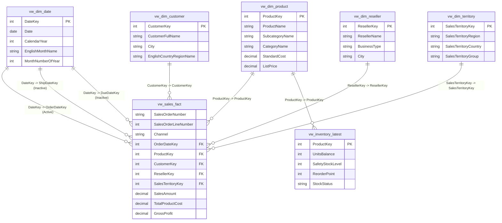

# MotoPulse 360: Power BI Semantic Model & Relationship Architecture

**Document Version:** 1.0  
**Target Environment:** Power BI Desktop (May 2024 or later)  
**Storage Mode:** Import Mode (recommended for performance and full DAX support)  
**Data Sources:** MySQL Database (`motopulse360` views) OR Clean CSV Exports (`data/processed/powerbi/`)

---

## 1. Architectural Overview

The MotoPulse 360 semantic model is architected as an enterprise-grade **Star Schema** optimized for high-performance tabular querying, DAX calculation efficiency, and intuitive self-service reporting.

By centralizing transactional events into `vw_sales_fact` and surrounding it with conformed dimension tables, the model adheres strictly to Kimball dimensional modeling principles:
- **Zero bi-directional relationship ambiguity:** All relationships are single-direction (`1 -> *`).
- **No many-to-many relationship traps:** Cardinality is strictly enforced from unique dimension primary keys to foreign keys.
- **Grain safety:** Sales order lines are held at the atomic natural grain `(SalesOrderNumber, SalesOrderLineNumber)` to eliminate the risk of Cartesian product inflation.



---

## 2. Table Catalog & Role Definitions

### 2.1 Fact Tables
| Table Name | Source Entity | Grain | Row Count | Role & Purpose |
|---|---|---|---|---|
| **`vw_sales_fact`** | `vw_sales_fact.csv` / SQL view | One Sales Order Line | 121,253 | Core analytical fact table holding transaction amounts, quantities, discounts, standard costs, and line-level profits across both Retail (Internet) and Wholesale (Reseller) channels. |
| **`vw_inventory_latest`** | `vw_inventory_latest.csv` / SQL view | One Product Snapshot | 606 | Operational snapshot fact providing the latest stock levels, reorder points, safety stock thresholds, and stock shortage alerts. |

### 2.2 Dimension Tables
| Dimension Name | Source Entity | Primary Key | Row Count | Hierarchies & Business Attributes |
|---|---|---|---|---|
| **`vw_dim_date`** | `vw_dim_date.csv` | `DateKey` | 3,652 | Standard corporate calendar (2010–2014). Supports time intelligence (`Year -> Quarter -> Month -> Date`). |
| **`vw_dim_product`** | `vw_dim_product.csv` | `ProductKey` | 606 | Product master catalog enriched with category classifications (`CategoryName -> SubcategoryName -> ProductName`). |
| **`vw_dim_customer`** | `vw_dim_customer.csv` | `CustomerKey` | 18,484 | B2C retail consumers with demographic attributes (Income, Education, Occupation) and geographic enrichment (`Country -> State -> City`). |
| **`vw_dim_reseller`** | `vw_dim_reseller.csv` | `ResellerKey` | 701 | B2B wholesale partners categorized by `BusinessType` (Value Added Reseller, Specialty Bike Shop, Warehouse). |
| **`vw_dim_territory`** | `vw_dim_territory.csv` | `SalesTerritoryKey` | 11 | Sales management hierarchy (`SalesTerritoryGroup -> SalesTerritoryCountry -> SalesTerritoryRegion`). |

---

## 3. Relationship Specifications

When configuring relationships in Power BI Model View (`Model` icon in the left ribbon), establish the following links:

| # | From Table (Fact) | Foreign Key | To Table (Dimension) | Primary Key | Cardinality | Cross-filter | State | Role / Purpose |
|---|---|---|---|---|---|---|---|---|
| 1 | `vw_sales_fact` | `OrderDateKey` | `vw_dim_date` | `DateKey` | Many-to-One (*:1) | Single | **Active** | Primary sales timeline |
| 2 | `vw_sales_fact` | `ShipDateKey` | `vw_dim_date` | `DateKey` | Many-to-One (*:1) | Single | Inactive | Fulfillment timeline (activated via `USERELATIONSHIP`) |
| 3 | `vw_sales_fact` | `DueDateKey` | `vw_dim_date` | `DateKey` | Many-to-One (*:1) | Single | Inactive | SLA timeline (activated via `USERELATIONSHIP`) |
| 4 | `vw_sales_fact` | `ProductKey` | `vw_dim_product` | `ProductKey` | Many-to-One (*:1) | Single | **Active** | Product rollups & category filtering |
| 5 | `vw_sales_fact` | `CustomerKey` | `vw_dim_customer` | `CustomerKey` | Many-to-One (*:1) | Single | **Active** | Retail demographic analysis (NULL for wholesale) |
| 6 | `vw_sales_fact` | `ResellerKey` | `vw_dim_reseller` | `ResellerKey` | Many-to-One (*:1) | Single | **Active** | Wholesale partner analysis (NULL for retail) |
| 7 | `vw_sales_fact` | `SalesTerritoryKey` | `vw_dim_territory` | `SalesTerritoryKey` | Many-to-One (*:1) | Single | **Active** | Regional performance slicing |
| 8 | `vw_inventory_latest` | `ProductKey` | `vw_dim_product` | `ProductKey` | Many-to-One (*:1) | Single | **Active** | Product stock & replenishment linkage |

---

## 4. Date Dimension Configuration

For Power BI Time Intelligence functions (`TOTALYTD`, `SAMEPERIODLASTYEAR`, `DATEADD`) to work accurately without bugs:
1. Select table `vw_dim_date` in the **Data** pane.
2. Navigate to **Table Tools** in the top ribbon.
3. Click **Mark as Date Table**.
4. In the dialog, select the column: **`Date`** (`FullDateAlternateKey`).
5. Confirm that validation passes ("Validated successfully").
6. Ensure that **`EnglishMonthName`** is sorted by **`MonthNumberOfYear`**:
   - Select column `EnglishMonthName`.
   - Ribbon: **Column Tools** -> **Sort by Column** -> select **`MonthNumberOfYear`**.
7. Ensure that **`CalendarQuarter`** is sorted by **`CalendarQuarter`**.

---

## 5. Ingestion Options (Connecting Power BI to the Data)

### Option A: Local CSV Import (Instant Setup - No Server Required)
1. Launch **Power BI Desktop**.
2. Click **Get Data** -> **Folder** (or **Text/CSV**).
3. Browse to the project folder:
   `d:\Projects\MotoPulse-360-Claude-Handover\MotoPulse-360\data\processed\powerbi\`
4. Select and load all 7 CSV files:
   - `vw_sales_fact.csv`
   - `vw_dim_date.csv`
   - `vw_dim_product.csv`
   - `vw_dim_customer.csv`
   - `vw_dim_reseller.csv`
   - `vw_dim_territory.csv`
   - `vw_inventory_latest.csv`
5. Click **Load**. All relationships will either auto-detect or can be set in 2 minutes following Section 3.

### Option B: MySQL Live Database Connection
If running against a live MySQL Community Server instance:
1. Ensure the MySQL database is initialized:
   ```powershell
   mysql -u root -p < sql/01_create_database.sql
   mysql -u root -p motopulse360 < sql/02_create_tables.sql
   mysql -u root -p motopulse360 < sql/07_views_and_kpis.sql
   ```
2. In Power BI Desktop: Click **Get Data** -> **MySQL Database**.
3. Server: `localhost:3306`, Database: `motopulse360`.
4. Enter credentials from `.env`.
5. Select the 7 production views (`vw_*`).
