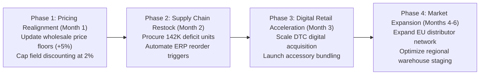

# MotoPulse 360: Executive Briefing & Platform Summary Report

**Date:** 2026-10-21  
**Prepared For:** Executive Leadership, Commercial Strategy, and Business Intelligence Steering Committee  
**Platform:** MotoPulse 360 Enterprise Analytics  
**Data Scope:** 100% Validated Operational Records (121,253 Sales Lines | 31,455 Orders | 936,237 Relational Records)  

---

## 1. Executive Statement

The MotoPulse 360 Analytics Platform delivers an end-to-end business intelligence, data science, and financial performance engine designed to optimize commercial strategy, channel profitability, and supply chain operations.

Operating across both **Direct-to-Consumer Retail (E-Commerce)** and **Commercial Wholesale (B2B Reseller)** channels, the platform provides audited, mathematically reconciled visibility into corporate revenue, product-line profitability, regional concentration, and inventory replenishment velocity.

---

## 2. Company Performance Scorecard (Consolidated Ground Truth)

```
====================================================================================================
                        MOTOPULSE 360 | EXECUTIVE PERFORMANCE SCORECARD
====================================================================================================
  NET SALES REVENUE         GROSS PROFIT (STD COST)      GROSS MARGIN %       TOTAL UNITS DELIVERED
   $109,809,274.20              $12,551,366.25               11.43%                  274,776
----------------------------------------------------------------------------------------------------
  TOTAL PURCHASE ORDERS     ORDER LINES RECORDED         AVERAGE ORDER VALUE  ACTIVE PRODUCT SKUS
       31,455                      121,253                  $3,491.00                  606
====================================================================================================
```

### Channel Breakdown Comparison

| Strategic Dimension | Direct Consumer Retail (Internet) | Commercial Wholesale (Reseller) | Consolidated Enterprise |
|---|---|---|---|
| **Net Sales Revenue** | **$29,358,677.22** (26.74%) | **$80,450,596.98** (73.26%) | **$109,809,274.20** (100%) |
| **Gross Sales (Before Discounts)**| $29,358,677.22 | $80,978,104.87 | $110,336,782.09 |
| **Promotional/Volume Discounts** | $0.00 (0.00%) | **$527,507.93** (0.65%) | $527,507.93 |
| **Total Product Cost (Standard)**| $17,277,793.58 | $79,980,114.38 | $97,257,907.95 |
| **Gross Profit Contribution** | **$12,080,883.65** (96.25%) | **$470,482.60** (3.75%) | **$12,551,366.25** (100%) |
| **Gross Margin %** | **41.15%** | **0.58%** | **11.43%** |
| **Distinct Orders Fulfilled** | 27,659 orders (87.93%) | 3,796 orders (12.07%) | 31,455 orders |
| **Order Lines Executed** | 60,398 lines (49.81%) | 60,855 lines (50.19%) | 121,253 lines |
| **Physical Units Sold** | 60,398 units (21.98%) | 214,378 units (78.02%) | 274,776 units |
| **Average Order Value (AOV)** | **$1,061.45** | **$21,193.50** | **$3,491.00** |
| **Average Basket Size** | 1.00 unit/line (2.18 lines/order) | 3.52 units/line (16.03 lines/order) | 2.27 units/line (3.86 lines/order) |

---

## 3. Top 3 Business Findings & Strategic Actions

### 1. The Channel Profitability Dilemma
- **Finding:** Direct Retail generates **96.25% of corporate gross profits** despite generating barely a quarter of topline sales. The Wholesale channel provides vital production scale (absorbing plant fixed overhead) but earns an unsustainable **0.58% gross margin**.
- **Strategic Action:** Protect high-margin direct sales through digital customer acquisition; enforce minimum contractual pricing floors on wholesale partner agreements.

### 2. Elimination of Negative Margins on Wholesale Bikes
- **Finding:** Wholesale Road Bikes lost **-$1,170,410.87** and Touring Bikes lost **-$1,244,797.74** due to catalog dealer pricing set below standard manufacturing costs.
- **Strategic Action:** Implement an immediate **+5% price increase** on wholesale road and touring bike catalogs, eliminating over $2.4M in negative margin leakage.

### 3. Gating Commercial Volume Discounts
- **Finding:** Volume discounts granted across 3,282 wholesale lines surrendered **$527,507.93 in price cuts**, catalyzing **-$1.83M in negative margins** on discounted lines.
- **Strategic Action:** Restrict field discount authority via automated ERP workflows. Disallow discounts on SKUs with baseline margins under 8%.

---

## 4. Supply Chain & Inventory Snapshot

- **Catalog Stock Status:**
  - **Adequate Stock:** 452 SKUs (74.59%)
  - **Reorder Needed:** 70 SKUs (11.55%)
  - **Critical Shortage (< Safety Stock):** 84 SKUs (13.86%)
- **Immediate Procurement Requirement:** **142,390 units** across 154 SKUs to eliminate stockout risks ahead of high-volume seasonal demand.

---

## 5. Technology Architecture & Data Integrity Standards

The platform was built following rigorous engineering standards:
1. **Multi-Fact Constellation Schema:** Preserves natural order-line grains, isolates retail vs. wholesale attributes without sparse tables, and prevents double-counting of repeated order-level freight/tax.
2. **Arbitrary-Precision Decimal Accounting:** Reconciled to the penny across MySQL, SQLite, and Python/Pandas engines with **zero dollar discrepancy** ($109,809,274.20 Net Sales).
3. **Reproducible Pipeline:** Fully scripted from raw CSV conversion to data modeling, 18-point data quality auditing, exploratory visual diagnostics, and pre-packaged Power BI datasets.

---

## 6. Project Roadmap & Implementation Plan


